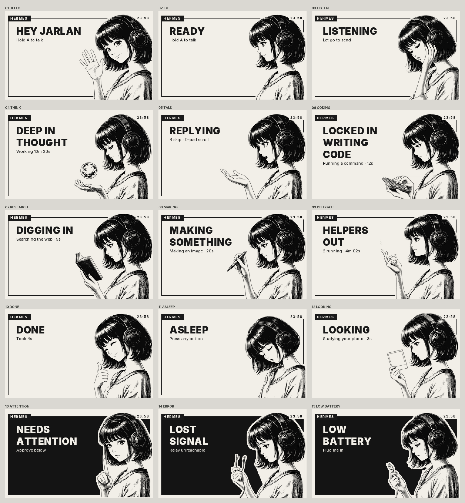

# Hermes 3DS

Talk to your [Hermes Agent](https://github.com/NousResearch/hermes-agent) from a Nintendo 3DS. Hold A, ask, and she answers out loud. She shows what she's doing while she works, asks before running anything risky, and can see through the 3DS camera.



## What it does

- **Push to talk.** Hold A, speak, let go. Your voice becomes text on your own computer (local Whisper).
- **Talks back.** Replies are spoken through the 3DS speaker if you run a local voice server (Kokoro). The first sentence starts playing while the rest is still being made.
- **Live state screens.** Thinking, writing code, searching the web, making something, sending helpers, needs your approval, low battery and more, each with its own pose.
- **Approvals.** When Hermes wants to run a command that needs your OK, the 3DS lights up and shows the command. A approves, B denies.
- **Camera.** Press R for a live viewfinder, snap, then hold A and ask about the photo.
- **Keyboard, history, new chat.** Y types, the bottom screen lists earlier answers, X starts fresh.
- **Home Menu app**, 3D depth on the top screen, and the notification LED when a reply is ready.

## How it works

```
3DS app  ──home Wi-Fi──>  relay.py  ──>  Hermes API server  (your agent, your model)
                              ├────>  speech to text      (local Whisper, required for voice)
                              └────>  text to speech      (local Kokoro, optional)
```

The 3DS can't talk to Hermes directly: it has no modern HTTPS and very little memory. `relay.py` is one Python file (standard library only) that runs on the computer next to Hermes and does the heavy work. Your API key stays on that computer. The 3DS only holds a pairing token.

## Quick start

You need a 3DS with homebrew ([3ds.hacks.guide](https://3ds.hacks.guide)), Hermes Agent, and Python 3.9+ on the same home network.

1. **Turn on the Hermes API server.** In `~/.hermes/.env` set `API_SERVER_ENABLED=true` and `API_SERVER_KEY=<any long random string>`, then restart Hermes (`hermes gateway`).
2. **Run the relay:** `python3 relay/relay.py doctor` checks everything, then `python3 relay/relay.py` starts it and prints the address to type on the 3DS.
3. **Install the app:** download `hermes-3ds.cia` (Home Menu, install with FBI) or `hermes-3ds.3dsx` (Homebrew Launcher, copy to `sd:/3ds/`) from [Releases](../../releases).
4. **Pair:** open the app, type the relay address, and it shows a 4-letter code. Run `python3 relay/relay.py pair CODE`, or just tell Hermes the code if you installed the skill.

Full guide, including local Whisper and voice: [docs/SETUP.md](docs/SETUP.md).

### Let Hermes set it up for you

`skill/hermes-3ds/SKILL.md` is a Hermes skill that walks your agent through setup, pairing and troubleshooting. Install it with:

```
hermes skills install https://raw.githubusercontent.com/<owner>/hermes-3ds/main/skill/hermes-3ds/SKILL.md
```

Then ask: "Set up the Hermes 3DS relay." Later, when the 3DS shows a code, say "Pair my 3DS, the code is HHDM."

## Controls

| Button | Does |
|---|---|
| A (hold) | Talk. While she's working, a follow-up for the same task |
| B | Stop her talking, stop the task, deny an approval, close the camera |
| X | New chat (or drop a pending photo) |
| Y | Type a message. On the offline screen: change the relay address |
| R | Camera viewfinder. A or R snaps |
| D-pad / circle pad | Page through long replies |
| SELECT | Voice on or off |
| START | Exit |

## Safety

The relay is for your home network only. It refuses requests from outside private address ranges, but it speaks plain HTTP because the 3DS can't do modern TLS. **Never port-forward it or put it behind a public tunnel.** A paired 3DS can ask your agent to do anything your agent can do, and risky commands still go through Hermes' normal approval prompt.

Photos you snap are sent to whatever model your Hermes uses. Voice audio only goes to the speech server you configure.

## Build from source

See [docs/BUILD.md](docs/BUILD.md). Short version: devkitPro with `3ds-dev`, then `make` in `app/`.

## Credits

- [Hermes Agent](https://github.com/NousResearch/hermes-agent) and the Hermes Girl character by [Nous Research](https://nousresearch.com). This is a fan project, not an official Nous Research app.
- [libctru](https://github.com/devkitPro/libctru) and [citro2d](https://github.com/devkitPro/citro2d) by devkitPro.
- [Whisper](https://github.com/openai/whisper) / [faster-whisper](https://github.com/SYSTRAN/faster-whisper), [Kokoro](https://huggingface.co/hexgrad/Kokoro-82M).
- Fonts: [Inter](https://rsms.me/inter/) and [JetBrains Mono](https://www.jetbrains.com/lp/mono/), SIL Open Font License.

## License

Code: MIT (see `LICENSE`). Hermes Girl artwork: see `NOTICE.md`.
